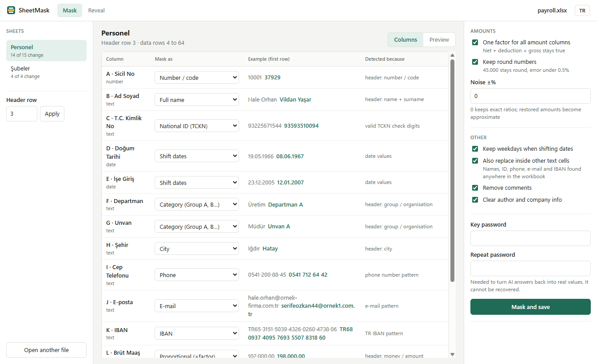
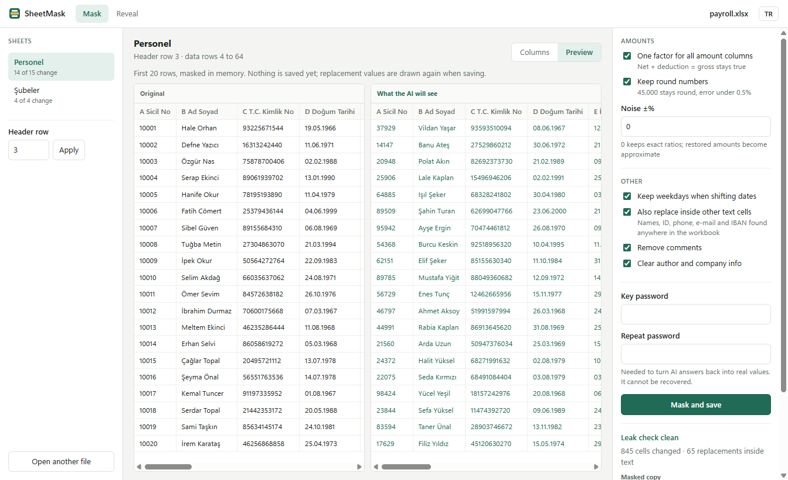
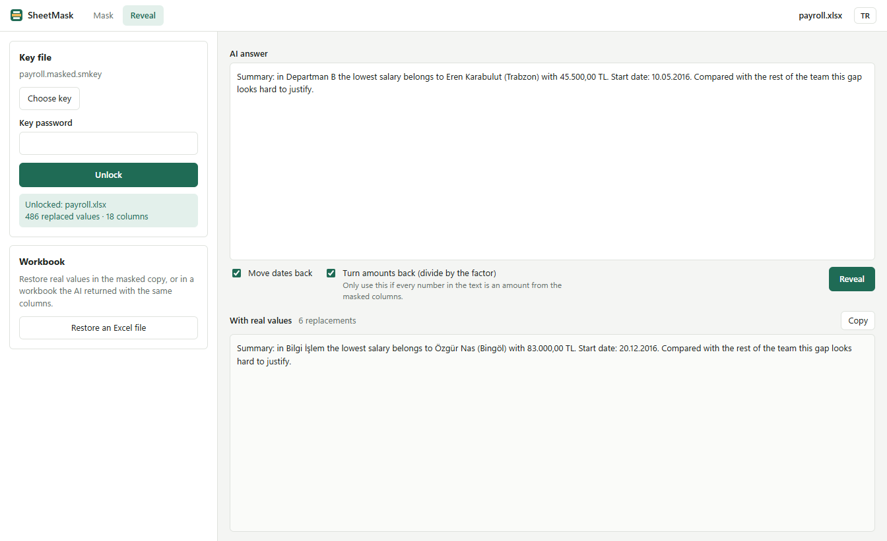

# SheetMask

**Pseudonymize Excel files before you paste them into ChatGPT, Claude, Gemini or any other AI tool, then turn the AI's answer back into real names and numbers.**

Offline Windows app. No AI inside, no network access, no account. Built with KVKK and GDPR in mind.

English · [Türkçe](README.tr.md)



## Why

You want an AI to analyse a payroll, a customer list or a sales sheet, but the file contains names, national IDs, phone numbers, IBANs and salaries that must not leave the company. Deleting those columns destroys the analysis. SheetMask replaces them with consistent, realistic fakes instead:

- the same person gets the same fake name in every sheet and every note,
- salaries are multiplied by one secret factor, so ratios, rankings and totals stay correct,
- dates move by one secret number of days, so intervals and weekdays stay correct.

The AI works on believable data. When it answers ("Elif Kaya in Department B earns 32.900, the lowest in the team"), SheetMask translates the answer back with a password-protected key that never leaves your machine.

## How it works

1. **Open** an `.xlsx`. SheetMask finds the header row and proposes a treatment for every column from its header and content (valid TCKN check digits, IBAN checksums, e-mail and phone patterns, built-in Turkish and English name, city and country lists).
2. **Review** the proposal. Change any column, and see the first rows side by side: original and what the AI will see.
3. **Save.** Next to the original you get:
   - `name.masked.xlsx`: send this to the AI,
   - `name.masked.smkey`: the key, encrypted with your password. Keep it to yourself.
4. **Reveal.** Paste the AI's answer, or open a workbook it returned. Fake names, IDs, places, dates and amounts become real again.

The original workbook is never modified.





## Column treatments

| Treatment | Example | What is preserved | Reversible |
|---|---|---|---|
| Proportional (×factor) | 45.000 → 32.900 | ratios, order, sums (one shared factor) | yes |
| Random number | 45.000 → 61.284 | min–max range | no |
| Full name / first name / surname | Ayşe Yılmaz → Elif Kaya | one person = one fake everywhere, gender, letter case | yes |
| City / country | Ankara → Kayseri | grouping | yes |
| Category | Sales → Department A | grouping | yes |
| National ID (TCKN) | fake with valid check digits | format | yes |
| Phone / e-mail / IBAN | realistic fakes, IBAN with a valid checksum | format, public mail domains | yes |
| Number / code | 10234 → 58812 | length and shape | yes |
| Address | fake street, number and town | | yes |
| Shift dates | every date moved by the same secret offset | intervals, weekdays | yes |
| Free text | names, IDs, phones, e-mails, IBANs and dates inside notes are replaced | the rest of the sentence | yes |
| Hide with stars | Ahmet → A***t | | no |
| Clear | emptied | | no |

A fake value is never equal to a real value anywhere in the workbook, so fakes and real data can always be told apart.

## Privacy and security

**Nothing leaves your computer.**

- The interface is a local web page served from inside the process (WebView2, virtual host `sheetmask.local`). The app opens no listening port and makes no outbound requests; navigation to any other address is blocked and SmartScreen reputation look-ups are switched off.
- No telemetry, no update check, no account. The only dependencies are [ClosedXML](https://github.com/ClosedXML/ClosedXML) (reads and writes `.xlsx`) and the WebView2 SDK.
- Measured: while opening, previewing and masking a workbook, the app and its WebView2 child processes held no TCP or UDP endpoint at all.

**The masked file is checked before you send it.**

- After saving, every XML part of the output (cells, shared strings, comments, pivot caches, link targets, document properties) is searched for the real values that should be gone. Anything found is listed.
- Comments, `mailto:` links and author/company properties are removed by default.
- Formulas are kept and recalculated, so totals match the masked values instead of leaking the real ones.

**The key is properly protected.**

- Fakes and the secret factor come from the operating system's cryptographic random generator, so they cannot be predicted from the masked file.
- The key file is encrypted with AES-256-GCM; the key is derived from your password with PBKDF2-SHA256 (600 000 iterations). A forgotten password cannot be recovered.

## Limits worth knowing

- A single shared factor can be worked out by anyone who knows one real amount. If that matters, add noise (±%); restored amounts then become approximate.
- Names outside a recognised column are found in free text only as a known first name followed by a known surname.
- While the key exists, pseudonymized data is still personal data under KVKK and GDPR. Share only the masked copy.
- Charts are dropped by ClosedXML. Old `.xls` files must be saved as `.xlsx` first.

## Performance

Measured on a laptop with a 20 000-row × 15-column workbook (3 MB):

| Step | Time |
|---|---|
| Open and analyse | ~6 s |
| Preview after a change | ~0.3 s |
| Mask, save, encrypt the key, leak check | ~20 s |
| Restore the whole workbook | ~10 s |

## Build

Requirements: Windows 10/11, [.NET 10 SDK](https://dotnet.microsoft.com/download), Microsoft Edge WebView2 Runtime (already part of Windows 11).

```powershell
dotnet build src/SheetMask.App -c Release
```

Single self-contained executable (about 150 MB, includes the .NET runtime, nothing to install):

```powershell
dotnet publish src/SheetMask.App -c Release -r win-x64 --self-contained -p:PublishSingleFile=true -p:IncludeNativeLibrariesForSelfExtract=true -p:IncludeAllContentForSelfExtract=true -o publish
```

You can also open a file directly: `SheetMask.exe payroll.xlsx`.

## Command line

`src/SheetMask.Cli` uses the same engine:

```powershell
dotnet run --project src/SheetMask.Cli -- sample demo.xlsx 200                    # realistic fake test workbook
dotnet run --project src/SheetMask.Cli -- analyze demo.xlsx                        # proposed treatment per column
dotnet run --project src/SheetMask.Cli -- mask demo.xlsx --password "..." --noise 2 --set "Personel!N=Scale"
dotnet run --project src/SheetMask.Cli -- reveal demo.masked.smkey --password "..." --text "AI answer..." --numbers --dates
dotnet run --project src/SheetMask.Cli -- reveal demo.masked.smkey --password "..." --xlsx demo.masked.xlsx
```

## Project layout

```
src/SheetMask.Core   detection, masking, key file, leak check, reveal (no UI)
src/SheetMask.App    WPF + WebView2 desktop app, interface in public/
src/SheetMask.Cli    command line front end and test tool
scripts/             icon generator
docs/screenshots/    images used in this README
```

## Licence

[MIT](LICENSE)
