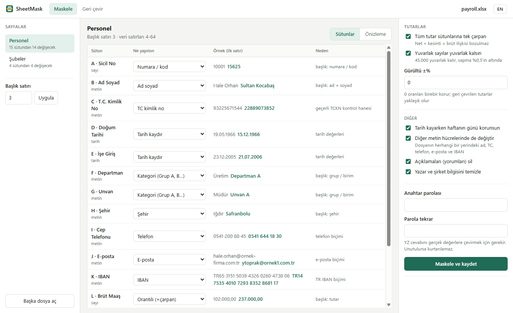
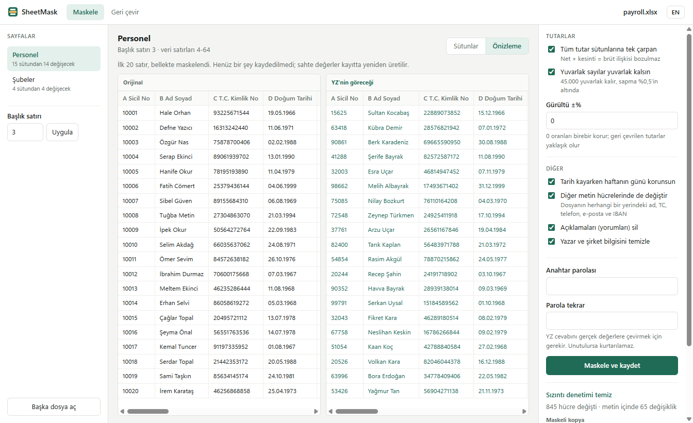
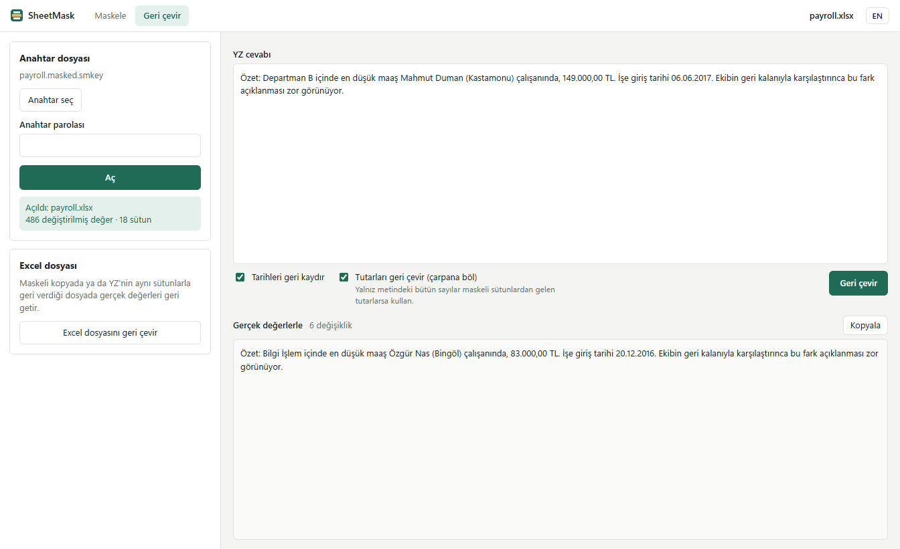

# SheetMask

**Excel dosyalarını ChatGPT, Claude, Gemini ya da başka bir YZ aracına yapıştırmadan önce takma adlandırır, YZ'nin cevabını yeniden gerçek ad ve sayılara çevirir.**

Çevrimdışı Windows uygulaması. İçinde YZ yok, ağa çıkmaz, hesap gerektirmez. KVKK ve GDPR düşünülerek yapıldı.

[English](README.md) · Türkçe



## Neden

Bir bordroyu, müşteri listesini ya da satış tablosunu YZ'ye analiz ettirmek istiyorsun ama dosyada şirketten çıkmaması gereken adlar, TC kimlik numaraları, telefonlar, IBAN'lar ve maaşlar var. O sütunları silmek analizi bozar. SheetMask bunun yerine tutarlı ve gerçekçi sahte değerler koyar:

- aynı kişi her sayfada ve her notta aynı sahte adı alır,
- maaşlar tek bir gizli çarpanla çarpılır; oranlar, sıralama ve toplamlar doğru kalır,
- tarihler aynı gizli gün sayısı kadar kayar; aralıklar ve haftanın günleri doğru kalır.

YZ inandırıcı veriyle çalışır. Cevap verdiğinde ("Departman B'deki Elif Kaya 32.900 ile ekibin en düşük maaşını alıyor") SheetMask, bilgisayarından hiç çıkmayan parolalı bir anahtarla cevabı gerçeğe çevirir.

## Nasıl çalışır

1. Bir `.xlsx` **aç**. SheetMask başlık satırını bulur; her sütun için başlığa ve içeriğe bakarak işlem önerir (geçerli TCKN kontrol haneleri, IBAN sağlaması, e-posta ve telefon biçimleri, hazır Türkçe ve İngilizce ad, şehir ve ülke listeleri).
2. Öneriyi **incele**. İstediğin sütunu değiştir; ilk satırları yan yana gör: orijinal ve YZ'nin göreceği.
3. **Kaydet.** Orijinalin yanında iki dosya oluşur:
   - `ad.masked.xlsx`: YZ'ye bunu gönder,
   - `ad.masked.smkey`: parolanla şifrelenmiş anahtar. Bu sende kalır.
4. **Geri çevir.** YZ'nin cevabını yapıştır ya da geri verdiği Excel'i aç. Sahte adlar, numaralar, yerler, tarihler ve tutarlar gerçeğe döner.

Orijinal dosyaya hiç dokunulmaz.





## Sütun işlemleri

| İşlem | Örnek | Korunan | Geri çevrilir |
|---|---|---|---|
| Orantılı (×çarpan) | 45.000 → 32.900 | oranlar, sıra, toplamlar (ortak çarpan) | evet |
| Rastgele sayı | 45.000 → 61.284 | en küçük–en büyük aralık | hayır |
| Ad soyad / ad / soyad | Ayşe Yılmaz → Elif Kaya | bir kişi = her yerde tek sahte ad, cinsiyet, harf büyüklüğü | evet |
| Şehir / ülke | Ankara → Kayseri | gruplama | evet |
| Kategori | Satış → Departman A | gruplama | evet |
| TC kimlik no | kontrol haneleri doğru sahte TCKN | biçim | evet |
| Telefon / e-posta / IBAN | gerçekçi sahteler, IBAN sağlaması doğru | biçim, genel e-posta alan adları | evet |
| Numara / kod | 10234 → 58812 | uzunluk ve biçim | evet |
| Adres | sahte sokak, numara ve ilçe | | evet |
| Tarih kaydır | bütün tarihler aynı gizli gün sayısı kadar kayar | aralıklar, haftanın günü | evet |
| Serbest metin | notların içindeki ad, TC, telefon, e-posta, IBAN ve tarihler değişir | cümlenin geri kalanı | evet |
| Yıldızla gizle | Ahmet → A***t | | hayır |
| Boşalt | silinir | | hayır |

Sahte bir değer, dosyadaki hiçbir gerçek değerle aynı olamaz; sahte ile gerçek her zaman ayırt edilir.

## Gizlilik ve güvenlik

**Hiçbir şey bilgisayarından çıkmaz.**

- Arayüz, sürecin içinden sunulan yerel bir web sayfasıdır (WebView2, sanal adres `sheetmask.local`). Uygulama dinleyen port açmaz, dışarıya istek atmaz; başka adreslere gitmek engellidir, SmartScreen itibar sorguları kapalıdır.
- Telemetri, güncelleme denetimi ve hesap yok. Bağımlılıklar yalnız [ClosedXML](https://github.com/ClosedXML/ClosedXML) (`.xlsx` okuma/yazma) ve WebView2 SDK.
- Ölçüldü: dosya açma, önizleme ve maskeleme boyunca uygulama ve WebView2 alt süreçleri hiçbir TCP ya da UDP ucu tutmadı.

**Maskeli dosya göndermeden önce denetlenir.**

- Kayıttan sonra çıktının bütün XML parçaları (hücreler, ortak metinler, yorumlar, pivot önbellekleri, bağlantı hedefleri, belge özellikleri) gitmesi gereken gerçek değerler için taranır. Bulunan her şey listelenir.
- Yorumlar, `mailto:` bağlantıları ve yazar/şirket bilgisi varsayılan olarak silinir.
- Formüller korunur ve yeniden hesaplanır; toplamlar gerçek değerleri sızdırmak yerine maskeli değerlerle tutar.

**Anahtar düzgün korunur.**

- Sahte değerler ve gizli çarpan işletim sisteminin kriptografik rastgele üretecinden gelir; maskeli dosyadan tahmin edilemez.
- Anahtar dosyası AES-256-GCM ile şifrelenir; şifreleme anahtarı parolandan PBKDF2-SHA256 (600 000 tur) ile türetilir. Unutulan parola kurtarılamaz.

## Bilinmesi gereken sınırlar

- Tek ortak çarpan, gerçek tutarlardan birini bilen biri tarafından hesaplanabilir. Önemliyse gürültü (±%) ekle; geri çevrilen tutarlar o zaman yaklaşık olur.
- Tanınmış bir sütunda olmayan adlar, serbest metinde yalnız "bilinen ad + bilinen soyad" ikilisi olarak bulunur.
- Anahtar var oldukça takma adlandırılmış veri KVKK ve GDPR açısından hâlâ kişisel veridir. Yalnız maskeli kopyayı paylaş.
- ClosedXML grafikleri korumaz. Eski `.xls` dosyalarını önce `.xlsx` olarak kaydet.

## Hız

20 000 satır × 15 sütunluk (3 MB) bir dosyayla dizüstü bilgisayarda ölçüldü:

| Adım | Süre |
|---|---|
| Açma ve analiz | ~6 sn |
| Değişiklikten sonra önizleme | ~0,3 sn |
| Maskeleme, kaydetme, anahtar şifreleme, sızıntı denetimi | ~20 sn |
| Bütün dosyayı geri çevirme | ~10 sn |

## Derleme

Gerekenler: Windows 10/11, [.NET 10 SDK](https://dotnet.microsoft.com/download), Microsoft Edge WebView2 Runtime (Windows 11'de hazır).

```powershell
dotnet build src/SheetMask.App -c Release
```

Tek dosyalık, kurulum gerektirmeyen exe (yaklaşık 150 MB, .NET çalışma zamanı içinde):

```powershell
dotnet publish src/SheetMask.App -c Release -r win-x64 --self-contained -p:PublishSingleFile=true -p:IncludeNativeLibrariesForSelfExtract=true -p:IncludeAllContentForSelfExtract=true -o publish
```

Dosyayı doğrudan da açabilirsin: `SheetMask.exe bordro.xlsx`.

Arayüz Türkçe ve İngilizcedir; Windows dili ya da bölge ayarı Türkçeyse Türkçe açılır, üst çubuktaki TR/EN düğmesiyle değiştirilebilir.

## Komut satırı

`src/SheetMask.Cli` aynı motoru kullanır:

```powershell
dotnet run --project src/SheetMask.Cli -- sample demo.xlsx 200                    # gerçekçi sahte test dosyası
dotnet run --project src/SheetMask.Cli -- analyze demo.xlsx                        # sütun başına önerilen işlem
dotnet run --project src/SheetMask.Cli -- mask demo.xlsx --password "..." --noise 2 --set "Personel!N=Scale"
dotnet run --project src/SheetMask.Cli -- reveal demo.masked.smkey --password "..." --text "YZ cevabı..." --numbers --dates
dotnet run --project src/SheetMask.Cli -- reveal demo.masked.smkey --password "..." --xlsx demo.masked.xlsx
```

## Proje yapısı

```
src/SheetMask.Core   tespit, maskeleme, anahtar dosyası, sızıntı denetimi, geri çevirme (arayüzsüz)
src/SheetMask.App    WPF + WebView2 masaüstü uygulaması, arayüz public/ altında
src/SheetMask.Cli    komut satırı ve test aracı
scripts/             simge üretici
docs/screenshots/    bu README'deki görseller
```

## Lisans

[MIT](LICENSE)
